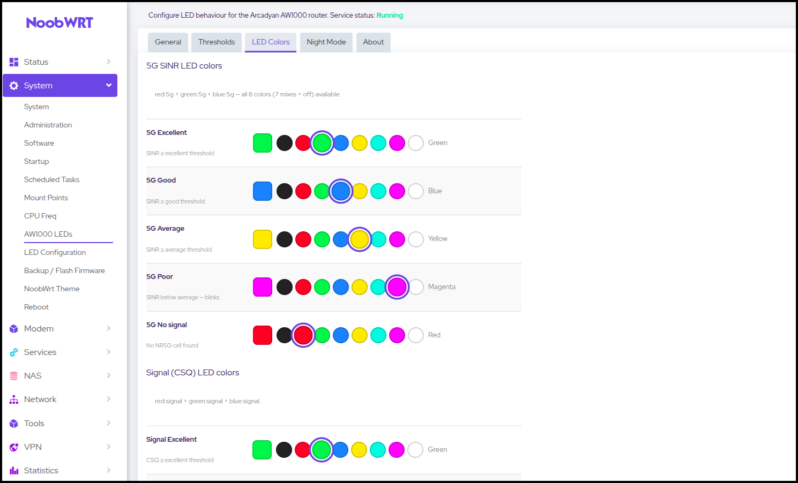

<div align="center">

# luci-app-aw1k-led

[](https://github.com/nooblk-98/luci-app-aw1k-led/actions/workflows/build.yml)
[](https://github.com/nooblk-98/luci-app-aw1k-led/releases)
[](https://openwrt.org)
[](Makefile)

Turn the front-panel LEDs of the **Arcadyan AW1000** into a live status display for 5G signal, mobile internet, Wi-Fi and the phone line, with a scheduled Night Mode. Everything is set up from LuCI.

[Features](#features) • [Installation](#installation) • [Configuration](#configuration) • [How it works](#how-it-works) • [Building](#building-from-source)



</div>

> [!IMPORTANT]
> This package drives the AW1000's LEDs through their `sysfs` names and talks to its built-in Quectel modem over AT commands. It does not work on any other router.

## Features

- **5G LED** shows NR5G signal quality (SINR) in one of five colors. It blinks when the signal is poor.
- **Signal LED** shows mobile signal strength (CSQ). It blinks when weak and turns a separate color when the internet is down.
- **Internet LED** stays solid while the mobile data link has a default route and blinks when it does not.
- **Wi-Fi LED** follows whether the radio is enabled.
- **Phone LED** follows the RJ11 line when [aw1000-rj11](https://github.com/nooblk-98/aw1000-rj11) is installed.
- **Night Mode** turns the status LEDs off on a daily schedule. The power LED keeps a slow double-blink beacon.
- **Custom colors and thresholds.** Each signal level can use any of 8 colors, and every SINR/CSQ cutoff can be changed.
- **AT port fallback.** The service tries the last working port, then QModem's ports, then every `ttyUSB*`, so the LEDs keep working when one AT port stops answering.

## Installation

### Requirements

- Arcadyan AW1000 running OpenWrt **24.10** (`.ipk`) or **25.12** (`.apk`)
- `sms-tool` (pulled in automatically as a dependency)
- `python3`, used only for the Night Mode power-LED beacon

### Install a release

Download the package for your OpenWrt version from the [Releases](https://github.com/nooblk-98/luci-app-aw1k-led/releases) page, copy it to the router, then run:

```sh
# OpenWrt 24.10
opkg install luci-app-aw1k-led_*.ipk

# OpenWrt 25.12
apk add --allow-untrusted luci-app-aw1k-led_*.apk
```

The service is enabled and started on install. To restart it by hand:

```sh
/etc/init.d/ledstatus restart
```

## Configuration

Open **System → AW1000 LEDs** in LuCI. The page has five tabs:

| Tab | What you can set |
|-----|------------------|
| **General** | Turn the service on or off, set the update interval (5–300 s), choose the modem AT port, restart the service |
| **Thresholds** | SINR cutoffs for the 5G LED and CSQ cutoffs for the Signal LED |
| **LED Colors** | A color for each signal level (red, green, blue, yellow, cyan, magenta, white, off) |
| **Night Mode** | Start and end time, plus buttons to enable or disable the schedule |
| **About** | Package information |

All settings are stored in `/etc/config/ledstatus`, so you can also change them from the shell:

```sh
uci set ledstatus.settings.interval='30'
uci set ledstatus.settings.color_5g_excellent='cyan'
uci commit ledstatus
/etc/init.d/ledstatus restart
```

### Defaults

| Level | 5G LED (SINR, dB) | Signal LED (CSQ) |
|-------|-------------------|------------------|
| Excellent | ≥ 25, green | ≥ 20, green |
| Good | ≥ 15, blue | ≥ 14, blue |
| Average | ≥ 5, yellow | ≥ 10, yellow |
| Poor / Weak | below average, magenta (blinking) | below average, red (blinking) |
| No signal / Offline | no NR5G cell, red | internet down, magenta |

## How it works

A procd service (`ledstatus`) runs a loop that calls `led-status-check.sh` every *interval* seconds. Each pass does the following:

1. Sends `AT+QENG="servingcell"` and `AT+CSQ` to the modem through `sms_tool` and reads SINR and CSQ from the replies.
2. Looks for a default route on `wwan0` or `wwan0_1` to tell whether mobile internet is up.
3. Reads `wireless.@wifi-device[0].disabled` to get the Wi-Fi state.
4. Writes the result to each LED's `trigger` and `brightness` files in `/sys/class/leds/`.

### LED map

| LED | sysfs name | Shows |
|-----|------------|-------|
| RGB | `{red,green,blue}:5g` | 5G signal quality (SINR) |
| RGB | `{red,green,blue}:signal` | Mobile signal (CSQ) |
| Green | `green:internet` | Internet connected |
| Green | `green:wifi` | Wi-Fi enabled |
| Green | `green:phone` | Phone line, set by aw1000-rj11's `rj11_led` or by `fxsd` |
| Green | `green:power` | Power, or the Night Mode beacon |

### Phone LED

When a phone service is installed ([aw1000-rj11](https://github.com/nooblk-98/aw1000-rj11), or `fxsd` from [openwrt-aw1000-phone](https://github.com/Perz3us/openwrt-aw1000-phone)), it controls this LED and the status loop leaves it alone:

| State | LED |
|-------|-----|
| Line ready | Solid |
| Incoming call | Fast blink |
| Handset off hook | Slow blink |
| Phone port disabled or not installed | Off |

### Night Mode

Enabling Night Mode adds two cron jobs, one at the start time and one at the end time. Windows that cross midnight, such as `21:00–07:00`, are supported. While Night Mode is active:

- the 5G, Signal, Internet and Wi-Fi LEDs are off and the update loop is paused
- the power LED does a slow double-blink
- the phone LED stays off except while a call is ringing

If you enable it during the night window, it takes effect immediately. You can also control it from the shell:

```sh
led-night-mode.sh enable   # save the schedule and install the crons
led-night-mode.sh disable  # remove the crons and restore the LEDs
led-night-mode.sh on       # start Night Mode now
led-night-mode.sh off      # end Night Mode now
```

## Troubleshooting

Run a single check in the foreground to see what the service reads:

```sh
/usr/bin/led-status-check.sh
```

```text
5G: Good (SINR=18 color=blue)
Internet: Connected
WiFi: Enabled
Phone: LED follows the phone line
Signal: Excellent (CSQ=24 color=green)
```

> [!TIP]
> If the output shows `5G: NO SIGNAL` while you do have a 5G connection, the modem isn't answering on any AT port. Check that `sms_tool -d /dev/ttyUSB2 at 'at+csq'` gets a reply, or set **Modem AT port** to a port you know works. The last port that answered is cached in `/tmp/led-at-port`.

> [!NOTE]
> The 5G LED shows red (no signal) whenever the modem is on LTE only, because it reads SINR from the `NR5G` serving-cell line.

## Building from source

This is a standard LuCI package. Clone it into the `package/` directory of an OpenWrt SDK or buildroot and compile it:

```sh
git clone https://github.com/nooblk-98/luci-app-aw1k-led.git package/luci-app-aw1k-led
make package/luci-app-aw1k-led/compile V=s
```

Every push to `main` that touches the package runs the [build workflow](.github/workflows/build.yml). It builds the `.ipk` with the 24.10.5 SDK and the `.apk` with the 25.12.1 SDK, then publishes both as a GitHub release tagged `v<PKG_VERSION>-<PKG_RELEASE>` from the [Makefile](Makefile).
