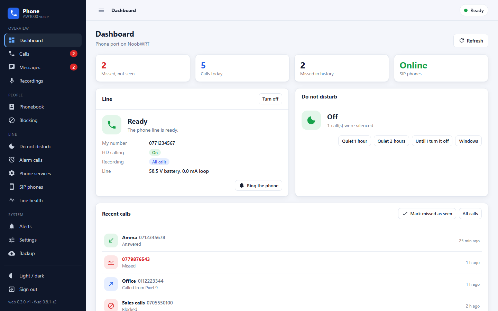
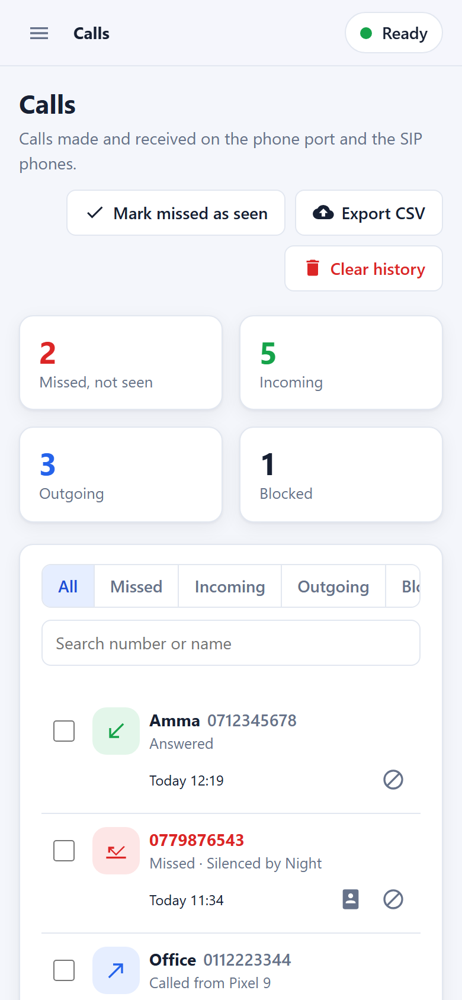
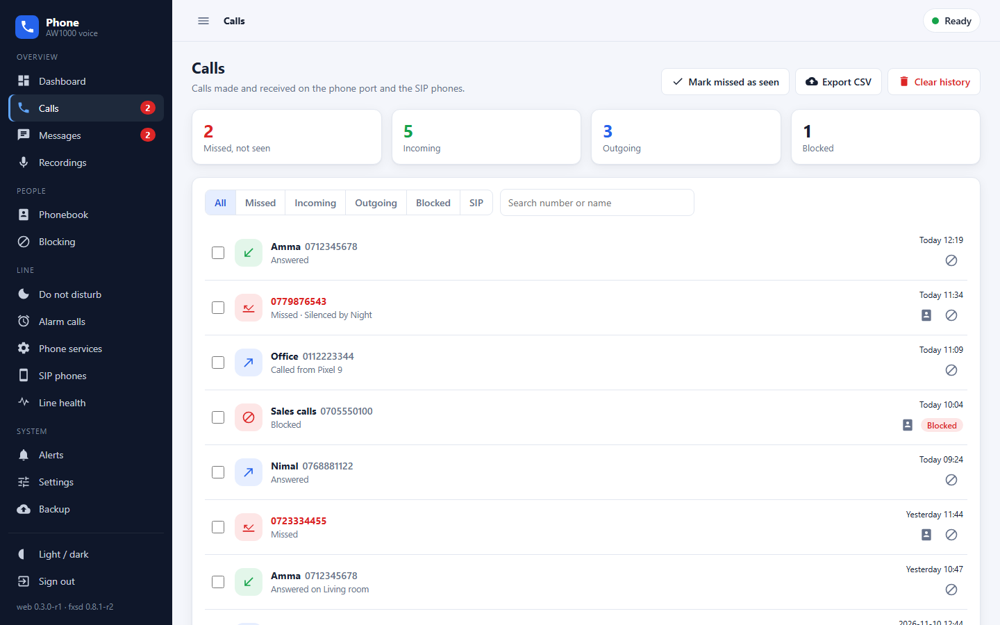
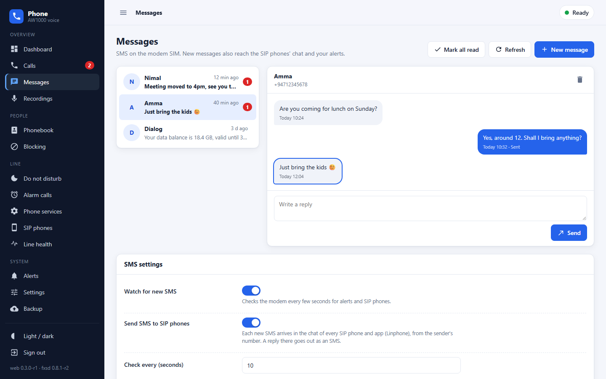
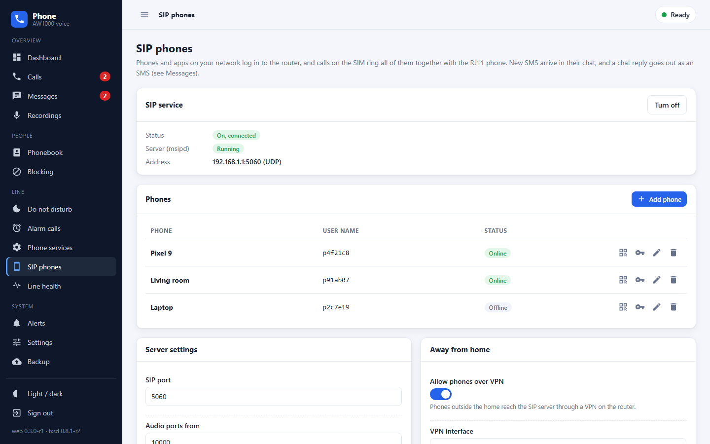
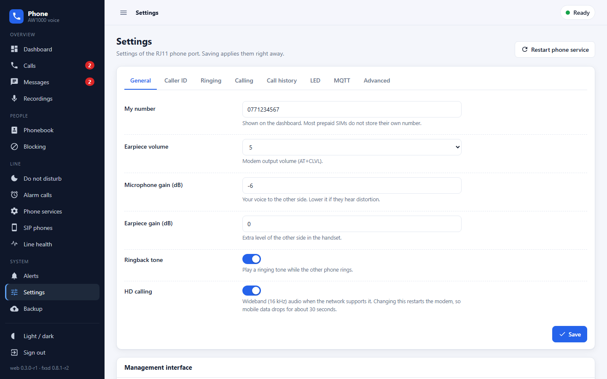
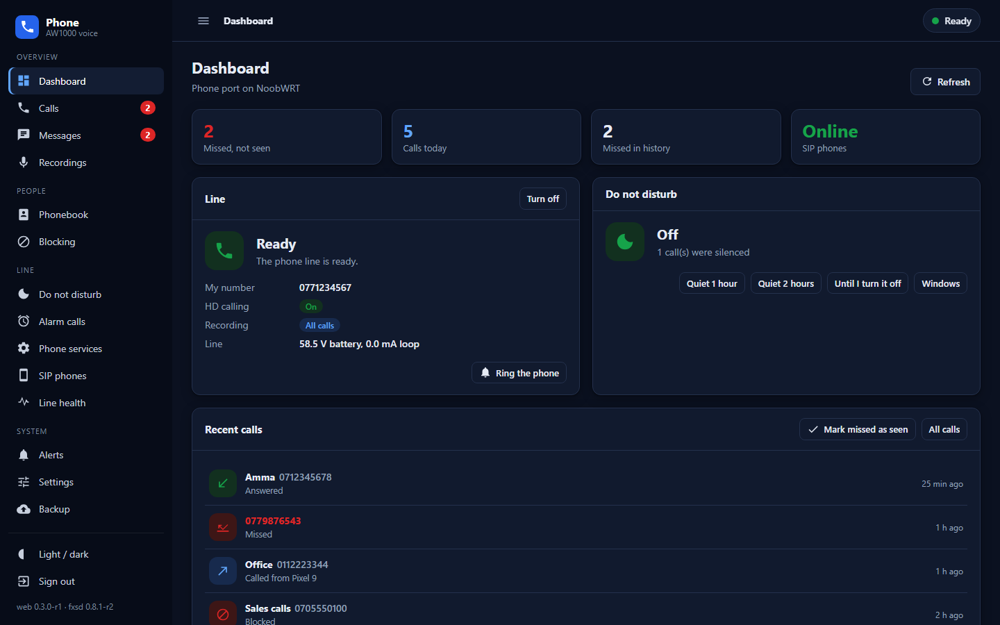
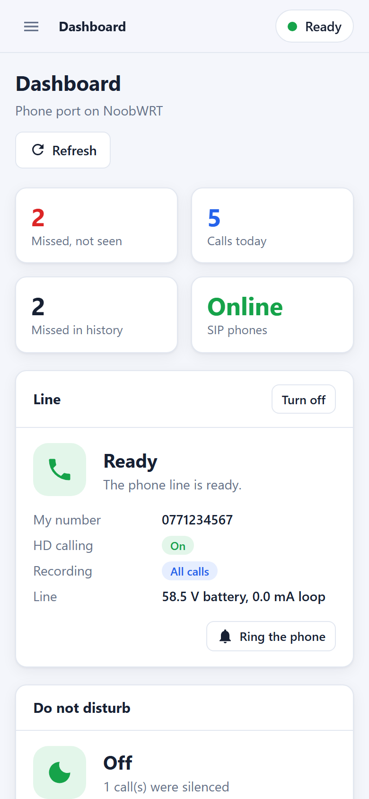
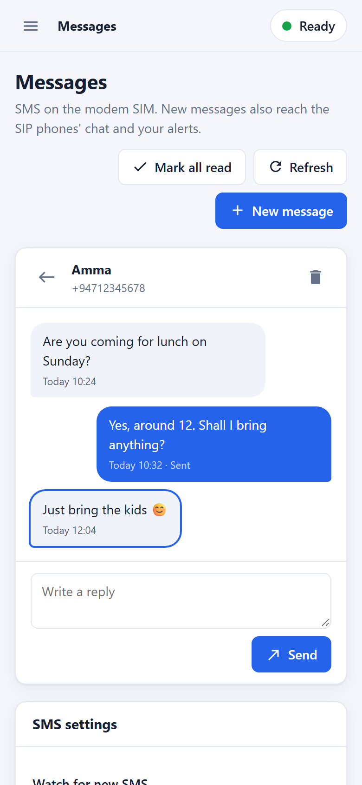
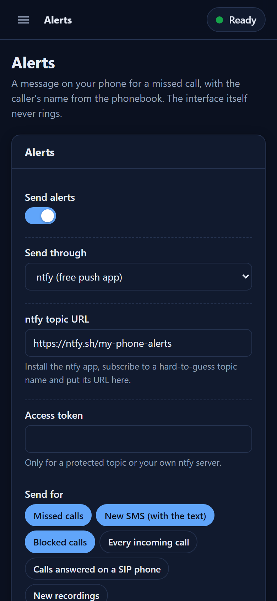

<h1 align="center">noobwrt-aw1000-voice</h1>

<p align="center">The RJ11 phone port and SIP phones of the Arcadyan AW1000, with their own management interface</p>

<p align="center">
  <a href="https://github.com/nooblk-98/noobwrt-aw1000-voice/actions/workflows/ci.yml"></a>
  
  <a href="https://openwrt.org"></a>
  
</p>

<p align="center">
  
  &nbsp;
  
</p>

One feed that brings together the AW1000 phone stack:

- the **RJ11 phone port**: the `aw1000-fxs` driver and the `fxsd` daemon from
  [openwrt-aw1000-phone](https://github.com/Perz3us/openwrt-aw1000-phone), at 0.8.1 with
  configurable modem PCM slots;
- **SIP phones and apps** on the LAN that call through the modem SIM: `msipd` from
  [openwrt-modem-sip](https://github.com/Perz3us/openwrt-modem-sip), extended here with
  **SMS over SIP**: new SMS arrive in the phones' chat, and a chat reply goes out as an SMS;
- a new **management interface** on its own port, with an **SMS inbox**, **alerts** for
  missed calls and new SMS, and a LuCI shortcut to it.

The management interface is for managing the phone: missed calls, the call history, SMS,
recordings and every setting. Calls are made and answered on the RJ11 phone or a SIP phone.

## Tested with

> [!IMPORTANT]
> Tested only on an Arcadyan AW1000 (Quectel RG500Q-EA) running
> [NoobWRT](https://github.com/nooblk-98/noobwrt-arcadyan-aw1k) firmware with
> **ModemManager** driving the modem (OpenWrt 25.12.5, kernel 6.12.94).
> It is **not tested with QModem**. SMS needs ModemManager (`mmcli`); the phone port and
> SIP calls talk to the modem's AT port, as in openwrt-aw1000-phone, and may work with
> QModem, but nobody has tried.

## Screenshots

All numbers and names in the screenshots are made up.

| Desktop | |
| --- | --- |
|  |  |
|  |  |
|  |  |

| Mobile | | | |
| --- | --- | --- | --- |
|  |  |  |  |

## Packages

| Package | What it is |
| --- | --- |
| `kmod-aw1000-fxs` | Clocks, SPI and PCM bridge for the Si32261 SLIC. Built for the exact kernel of your firmware. |
| `fxsd` | The phone port daemon: dial tone, ringing, caller ID, call waiting, DND, recording, alarms, MQTT. |
| `modem-sip` | `msipd`, a small SIP server so LAN phones and apps share the SIM with the RJ11 phone, for calls and SMS (SIP MESSAGE). |
| `aw1000-voice-web` | The management interface (port 7766), the SMS watcher, alerts, and the `fxs`, `modem-sip` and `aw1000-voice` rpcd backends. Replaces `luci-app-fxs` and `luci-app-modem-sip`. |
| `luci-app-aw1000-voice` | Services → Phone in LuCI: the line state and an **Open management interface** button. |

## The management interface

`http://<router>:7766/`, signed in with the router's own user name and password (rpcd).

| Page | What it does |
| --- | --- |
| Dashboard | Line state, missed calls not seen yet, calls today, quick quiet, recent calls, versions |
| Calls | History with filters (missed, incoming, outgoing, blocked, SIP), search, names and reasons, recordings, add a caller to the phonebook or block them in one tap, CSV export |
| Messages | SMS on the SIM as conversations, with phonebook names and unread counts: read, reply, write a new SMS (with a part counter), delete; SMS watcher and SIP chat settings |
| Recordings | Play, save, keep or delete recordings; recording rules and space limits |
| Phonebook | Contacts with ring and DND priority, and speed dial codes |
| Blocking | Blocked numbers and ranges, hidden numbers, outgoing allow or block lists |
| Do not disturb | Quiet now, the always-ring list, weekly windows and holidays |
| Alarm calls | Wake-up rings by time and day |
| Phone services | Call forwarding and USSD codes through the modem |
| SIP phones | Turn the SIP service on, add phones, QR codes for Linphone, logins, ports, HD, VPN |
| Line health | Battery, line voltage and loop current, driver and patch checks, the no-audio-from-modem warning, ring tests, service restarts, the phone log |
| Alerts | Push a message to your phone for missed calls and new SMS (and blocked calls, every call, SIP answers or new recordings) through **ntfy**, a **Telegram** bot or a **webhook** |
| Settings | Every `fxsd` option: caller ID, ringing, calling, history, LED, MQTT, advanced |
| Backup | Download and restore every phone setting and the call history |

It is plain HTML, CSS and JavaScript modules with no build step, under
`/www/aw1000-voice/` on the router:

- **Restyle** everything from `css/theme.css`: colors, radius, fonts, light and dark.
- **Add or change a page** in `js/pages/`, list it in the navigation in `js/app.js` and in
  the import map in `index.html` (`node scripts/check-web.mjs` tells you if you forget).
- **Updates are never mixed with a stale cache**: every module URL carries the package
  version.
- **Add it to your phone's home screen**: it opens full screen like an app.

### Where it listens

By default only on the LAN address, on port 7766, through its own uhttpd instance
(`uhttpd.phone`), so it does not depend on LuCI. It follows a changed LAN address by itself.

```sh
uci set aw1000_voice.web.port=7766
uci set aw1000_voice.web.listen=lan     # or all
uci commit aw1000_voice
/usr/libexec/aw1000-voice-web-setup
```

### Alerts

`fxsd` runs `/etc/fxs/hook.sh` on every call event. The package installs a small hook there
that hands the event to `/usr/libexec/aw1000-voice-notify`, which looks the caller up in the
phonebook and sends the message. If you already have your own `hook.sh`, it is left alone;
call `/usr/libexec/aw1000-voice-notify "$1" "$2"` from it to keep both.

### SMS and SMS over SIP

SMS are read and sent through ModemManager (`mmcli`). The `aw1000-voice-sms` service checks
the modem every 10 seconds; each new SMS goes to the alerts (event **New SMS**) and to the SIP
phones:

- **SMS to the SIP phones.** `msipd` sends a SIP `MESSAGE` from `sip:<sender>@<router>`
  to every phone that is logged in, so the text shows in the app's chat (Linphone and most
  SIP apps), with the phonebook name. A phone that is away gets it when it logs in again
  (kept in memory for a week, up to 32 messages).
- **SMS from the SIP phones.** Write in the chat to the sender, or start a chat with
  `sip:<number>@<router>`: `msipd` hands the text to the modem as an SMS. If it fails,
  the phone gets a chat message that says why.
- Typing and delivery notices from the apps are accepted and ignored; only text messages
  become SMS. Senders like `Airtel` or `700` cannot be answered.

```sh
uci set aw1000_voice.sms.enabled=1    # watch for new SMS
uci set aw1000_voice.sms.sip=1        # forward them to the SIP phones
uci commit aw1000_voice
```

Other tools can use the same paths: `ubus call fxs_sip sms '{"from":"+9477...","name":"...","text":"..."}'`
sends a chat message to the phones, and `/usr/libexec/aw1000-voice-sms list|send|delete`
reads and sends SMS.

### Modem PCM slots

If a call connects but has no sound from the modem, Line health says so. A board wired
differently can move the PCM slots without a rebuild:

```sh
uci set fxs.main.modem_slots='1,0'   # bridge rx,tx slot
uci set fxs.main.qdai_slot='1'       # AT+QDAI slot
uci commit fxs && /etc/init.d/fxsd restart
```

## Build

The kernel module has to match your firmware's kernel build, so build these packages in the
same OpenWrt tree as the firmware. Add this repository as a feed:

```
src-git aw1000voice https://github.com/nooblk-98/noobwrt-aw1000-voice.git
```

then

```sh
./scripts/feeds update aw1000voice
./scripts/feeds install -p aw1000voice -a
make package/aw1000-fxs/compile package/fxsd/compile package/modem-sip/compile \
     package/aw1000-voice-web/compile package/luci-app-aw1000-voice/compile
```

`fxsd` needs the SLIC patch file at run time (`/etc/fxs/si3226x_patch.bin`); see
[docs/hardware.md](docs/hardware.md). `modem-sip` needs `libre` and `libopus` from the
OpenWrt package feeds. `aw1000-voice-web` and `luci-app-aw1000-voice` are architecture
independent.

[NoobWRT](https://github.com/nooblk-98/noobwrt-arcadyan-aw1k) builds these packages from
[noobwrt-custom-feeds](https://github.com/nooblk-98/noobwrt-custom-feeds).

## Install on a running router

Remove the old LuCI pages first, they ship the same rpcd backends:

```sh
apk del luci-app-fxs luci-app-modem-sip
apk add --allow-untrusted ./kmod-aw1000-fxs-*.apk ./fxsd-*.apk ./modem-sip-*.apk \
    ./aw1000-voice-web-*.apk ./luci-app-aw1000-voice-*.apk
```

## Development

```sh
node scripts/check-web.mjs                 # module syntax, import map, JSON
make -C fxsd test                          # fxsd unit tests
python3 scripts/screenshots/mock_server.py # the interface on demo data, http://127.0.0.1:8766/
node scripts/screenshots/shoot.mjs <chrome> # retake docs/img/*.png
```

## Docs

[Hardware and the SLIC patch](docs/hardware.md) · [Settings](docs/settings.md) ·
[Recording](docs/recording.md) · [SIP phones](docs/sip.md) · [SIP services](docs/sip-services.md) ·
[Scripts and MQTT](docs/scripts.md) · [Problems](docs/problems.md)

## Credits and license

GPL-2.0, see [LICENSE](LICENSE) and [CREDITS.md](CREDITS.md). The phone port and SIP
server are the work of perz3us. `msipd/src/g722.c` comes from spandsp and stays under
LGPL-2.1.
